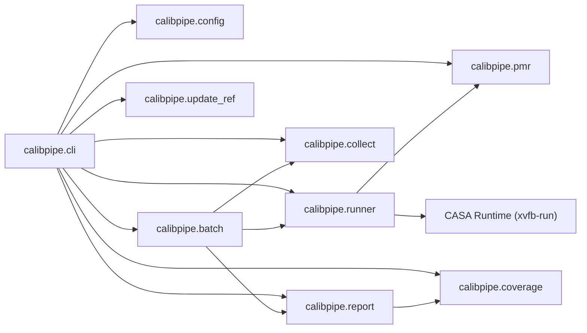

# API Reference

`calibpipe` provides modular Python interfaces for command-line parsing, TOML configuration loading, single-run execution, and Slurm batch management.

## Module Summary

| Module | Description |
| :--- | :--- |
| [`calibpipe.cli`](cli.md) | Unified command-line entry point and subcommand routing (`run`, `submit`, `pmr`, `env`, `config`, `profile`, `collect`, `report`, `coverage`, `update-ref`). |
| [`calibpipe.config`](config.md) | TOML configuration loader, environment resolution, and path reachability validation. |
| [`calibpipe.runner`](runner.md) | Single-run pipeline orchestrator, log management, and CASA subprocess execution. |
| [`calibpipe.batch`](batch.md) | Slurm and HTCondor batch submission generator, frozen TOML snapshot writer, pipefile parser, and submit-host guards. |
| [`calibpipe.collect`](collect.md) | Test discovery, node collection, and runfile generation for regression test arrays. |
| [`calibpipe.coverage`](coverage.md) | Programmatic coverage search, path remapping, and consolidated HTML reporting. |
| [`calibpipe.report`](report.md) | Test result synthesis, JUnit XML consolidation, and distributed coverage combining. |
| [`calibpipe.update_ref`](update_ref.md) | Regression reference (`*.results.txt`) merging, tolerance preservation, and candidate staging. |
| [`calibpipe.pmr`](pmr.md) | Pipeline Make Request wrapper and ALMA archive data fetcher. |

---

## Architecture Overview

