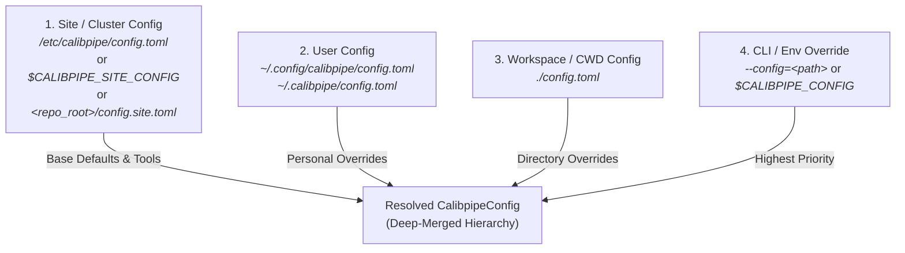
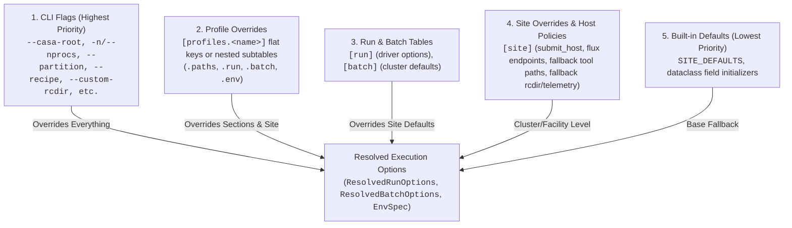
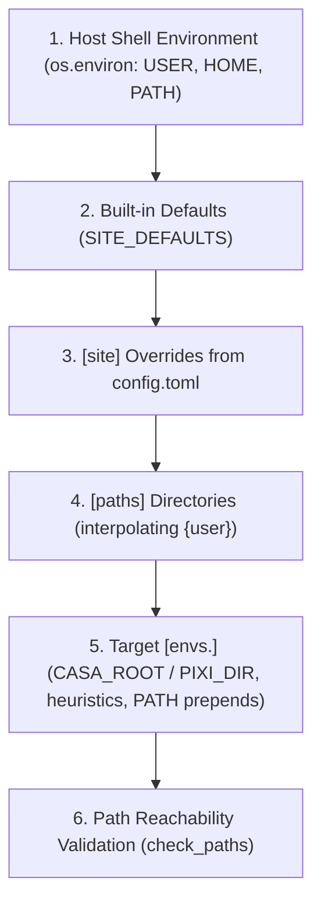
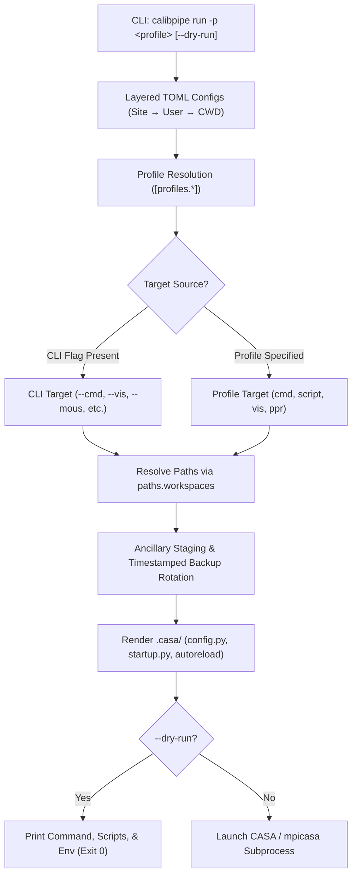
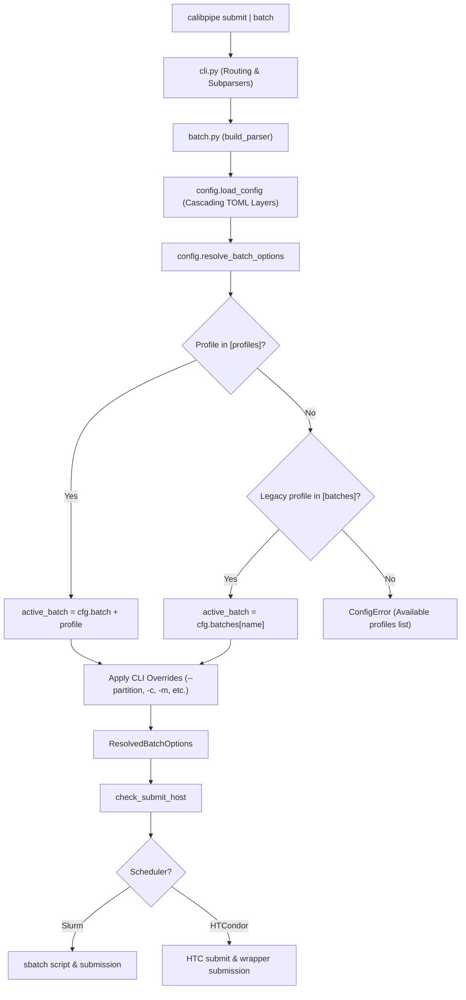

# calibpipe Documentation

`calibpipe` is a lightweight helper package for launching single-run and batch ALMA Science Pipeline jobs outside the main `pipeline` Python package. It is intended for validation, testing, and development workflows where operators and developers need a stable command-line interface, reproducible environment selection, and backward-compatible wrappers around existing `calibPipeIF.py` and `runbatch.py` usage patterns.

---

## Overview

Use `calibpipe` when you need to:

- run a single MOUS from the command line without entering an interactive CASA session
- submit many MOUS runs to Slurm from a pipefile
- resolve CASA and pipeline environment variables from TOML configuration instead of ad hoc shell scripts
- preserve compatibility with existing scripts that still call `calibPipeIF.py`, `runbatch.py`, or `calibpipe_env.sh`

`calibpipe` does not replace the main `pipeline` package. The `pipeline` repository still provides the reduction framework, heuristics, task implementations, and weblog generation. Rather than an operational pipeline driver, `calibpipe` is a lightweight driver used for validation and testing without larger production machinery entangled, selecting a configured CASA + pipeline environment and launching a run with the requested inputs.

---

## Repository Layout

The project is organized as follows:

```text
calibpipe/
├── README.md
├── config.example.toml
├── docs/
│   ├── index.md
│   ├── guide.md
│   └── api/
├── scripts/
│   ├── calibPipeIF.py
│   ├── calibpipe_env.sh
│   └── runbatch.py
├── src/
│   └── calibpipe/
│       ├── cli.py
│       ├── config.py
│       ├── runner.py
│       ├── batch.py
│       ├── pmr.py
│       └── steps/
└── tests/
```

Key implementation modules:

- `scripts/` contains backward-compatible runner shims (`calibPipeIF.py`, `runbatch.py`, `calibpipe_env.sh`).
- `src/calibpipe/cli.py` provides the unified command-line interface.
- `src/calibpipe/config.py` loads TOML configuration and builds the runtime environment.
- `src/calibpipe/runner.py` orchestrates a single pipeline run.
- `src/calibpipe/batch.py` generates and submits Slurm jobs.
- `src/calibpipe/pmr.py` wraps ALMA MakeProcessingRequests for directory structure and data fetching.
- `src/calibpipe/steps/` houses modular execution phases (such as input staging).

---

## Installation & Setup

### 1. Development Environment with `uv` (Recommended)

`calibpipe` uses [`uv`](https://docs.astral.sh/uv/) as its primary package and environment manager.

From the repository root, sync the virtual environment with development and documentation extras:

```bash
cd /path/to/calibpipe
uv sync --extra dev --extra docs
```

You can then run any `calibpipe` command directly inside the managed environment using `uv run`:

```bash
# Inspect resolved configuration
uv run calibpipe config show --env=main

# Run a single MOUS reduction
uv run calibpipe run --mous=uid://A001/X128a/Xb9 --env=main

# Submit batch jobs to Slurm
uv run calibpipe batch quick.run --env=main

# Run tests
uv run --extra dev pytest tests/
```

### 2. Isolated Tool Installation via `uv tool` (Recommended on Clusters)

To make `calibpipe` directly accessible in your `$PATH` across the cluster without needing `uv run` or manual venv activation:

```bash
uv tool install --editable /path/to/calibpipe
```

Because `--editable` is passed, the CLI stays synchronized with your checkout. You can then invoke commands directly from any working directory:

```bash
calibpipe run --mous=uid://A001/X128a/Xb9 --env=main
```

### 3. Alternative Installation Methods

- **Standard Editable Install via `pip`:**

  ```bash
  pip install -e .
  ```

- **Isolated Install via `pipx`:**

  ```bash
  pipx install /path/to/calibpipe
  ```

### Tip: Relocating the `uv` Cache Off NFS Home Directories

On HPC clusters where `$HOME` is NFS-backed, the default `uv` cache directory (`~/.cache/uv`) can cause two problems:

1. **Disk quota exhaustion** — the cache grows unbounded (no automatic eviction) and counts against your home directory quota.
2. **Cross-filesystem hardlink failures** — `uv` installs packages by hardlinking files from its cache into virtual environments. Hardlinks cannot cross filesystem boundaries. When the cache is on NFS and the venv lives on a local scratch filesystem (or vice versa), `uv` falls back to full file copies, producing warnings like `Failed to hardlink files; falling back to full copy`.

#### Solution: Redirect the Cache to Local Scratch

Set `UV_CACHE_DIR` to a path on a fast local or parallel filesystem:

```bash
# Add to ~/.bashrc (or your site's shell profile)
export UV_CACHE_DIR="/scratch/$USER/.cache/uv"
```

Verify the active cache location at any time:

```bash
uv cache dir
```

#### Fix the Link-Mode Separately (if needed)

If your venv and the cache still reside on different filesystems (e.g. project workspace on NFS, cache on local scratch), set the install link mode to `copy` to suppress the cross-device fallback warning:

```bash
export UV_LINK_MODE=copy          # via environment variable
# or per-invocation:
uv sync --link-mode=copy
```

> [!NOTE] `copy` mode is slower and uses more disk space per venv than hardlinks, because each venv receives its own copy of every package file. Placing `UV_CACHE_DIR` on the same filesystem as your project avoids this trade-off entirely.

#### Cache Maintenance

`uv` does not automatically limit cache size. Prune stale entries periodically:

```bash
uv cache prune    # removes unused/outdated entries (safe, non-destructive)
uv cache clean    # wipes the entire cache (forces fresh downloads on next use)
```

---

> [!WARNING] Observatory Infrastructure & Cluster Dependency
>
> `calibpipe` is an execution driver designed for ALMA Science Pipeline operations on observatory HPC clusters (e.g., NAASC cluster) and specialized pipeline workstations. Running `calibpipe` with arbitrary custom configurations on a standard personal workstation will **not work out-of-the-box** unless you have access to valid ALMA pipeline installations, Slurm, ALMA datapacker, and `pipelineMakeRequest` (PMR).
>
> If you are working on an observatory cluster, refer to your site administrator or internal templates (e.g. `notes/config.internal.example.toml`).

---

## Configuration

`calibpipe` uses a structured TOML configuration model designed for both standalone developer workstations and multi-user observatory HPC clusters (e.g., NAASC cluster).

### 1. Cascading Configuration Architecture

Rather than requiring users to duplicate cluster-wide tooling and CASA paths into private configuration files, `calibpipe` discovers and **deep-merges** configuration across a multi-layer hierarchy:



#### Discovery Precedence (Lowest to Highest Priority)

1. **Site / System Configuration (Base Defaults):**
   - `$CALIBPIPE_SITE_CONFIG` environment variable (if set, must exist)
   - `/etc/calibpipe/config.toml` (standard Linux system configuration)
   - `config.site.toml` in repository or package root
   - *Maintained by cluster admins*: provides shared cluster tools (`pmr_home`, `datapacker_home`, `java_home`, `acsdata`), cluster Slurm queues (`[batch]`), and canonical production CASA installations (`[envs.main]`, `[envs.modular]`).
2. **User Configuration (`~/.config/calibpipe/config.toml` & `~/.calibpipe/config.toml`):**
   - XDG location: `~/.config/calibpipe/config.toml` (or `$XDG_CONFIG_HOME/calibpipe/config.toml`)
   - Home dot-directory: `~/.calibpipe/config.toml`
   - *User-specific overrides*: personal scratch paths (`scipipe_rootdir = "/lustre/.../{user}"`), personal Slurm email, or developer feature environments (`[envs.my_branch]`). If both user files exist, `~/.calibpipe/config.toml` overlays on top of XDG settings.
3. **Workspace Configuration (`./config.toml` or `./.calibpipe.toml`):**
   - Project- or directory-specific settings when running from a dedicated workspace.
4. **Explicit CLI / Runtime Override (`--config=<path>` or `$CALIBPIPE_CONFIG`):**
   - Highest-priority overlay for custom or ad hoc runs.
   - Layers on top of the site configuration unless isolated mode is requested.

#### Deep-Merging Rules

- **`[paths]` & `[site]`:** Keys are merged recursively. User-specified values override site values, while all unmentioned site settings (`obscaldir`, `pmr_home`, `acsdata`, etc.) are seamlessly inherited.
- **`[batch]`:** Slurm partition and resource defaults are inherited from the site configuration. A user only needs to specify what they wish to customize (e.g. `mail_type = "FAIL"`).
- **`[envs]` (Additive & Overriding):** Environment tables are additive. If the site defines `[envs.main]` and `[envs.modular]`, and a user config defines `[envs.custom_pixi]`, **all three** environments are available to the user. If an environment name collides, the user's table overlays the site's definition.

#### Running in Isolated Mode (`--no-site-config`)

For isolated test suites or benchmarking runs where site defaults should be ignored completely:

```bash
# Via CLI flag
calibpipe run --mous=uid://A001/X1/X1 --config=isolated.toml --no-site-config
calibpipe batch myjob.txt --config=isolated.toml --no-site-config

# Or via environment variable
export CALIBPIPE_NO_SITE_CONFIG=1
```

---

### 2. Cascading Parameter Resolution Order

When `calibpipe run` or `calibpipe submit` prepares an execution or batch submission, configuration parameters are resolved across a strict 5-level precedence cascade:



1. **CLI Flags (Highest Priority):** Explicit command-line arguments (e.g. `--casa-root`, `--heuristics-dir`, `-n 16`, `--partition=queue`, `--custom-rcdir`, `--logfile`) take precedence over all profile and file-based settings.
2. **Profile Overrides:** Settings defined within the selected execution profile (`[profiles.<name>]`). Profiles override both `[run]` and `[site]` sections, supporting flat keys or modular subtables:
   - `[profiles.<name>.env]` or flat `casa_root`, `heuristics_dir`, `pixi_dir`, `pixi_env`, `branch`
   - `[profiles.<name>.paths]` or flat `workspaces`, `casadata`, `scipipe_rootdir`, `scipipe_logdir`
   - `[profiles.<name>.run]` or flat `recipe`, `nprocs`, `loglevel`, `verbose`, `log2term`, `use_custom_rcdir`, `casa_enable_telemetry`, `omp_num_threads`, `mem_frac`, etc.
   - `[profiles.<name>.batch]` or flat `partition`, `cores`, `mem`, `mem_per_cpu`, `cpus_per_task`, etc.
3. **Run & Batch Section Defaults:** Top-level execution defaults defined in `[run]` (for local/driver options) and `[batch]` (for Slurm/HTCondor submission options). For example, `[run].use_custom_rcdir = false` or `[run].casa_enable_telemetry = true` cleanly overrides site-level defaults for all runs.
4. **Site & Cluster Overrides:** Facility-wide infrastructure settings and defaults from `[site]` (`submit_host`, `strict_paths`, fallback tool locations, `flux_service_url`, `flux_service_url_backup`). Tool paths configured in `[paths]` automatically mirror with `[site]` bidirectionally for backward compatibility.
5. **Built-in System Defaults (Lowest Priority):** Built-in observatory fallbacks and typed dataclass field initializers (`SITE_DEFAULTS`).

#### Subtable vs. Flat Key Equivalence

Profiles accept parameters in two equivalent formats. Both representations normalize to the same typed `ProfileConfig` fields:

```toml
# Format A: Flat profile keys
[profiles."vlass/7x3"]
casa_root = "casa-6.7.7-15-py3.12.el8"
heuristics_dir = "PROJ-101/pipeline"
nprocs = 8
partition = "queue"
cpus_per_task = 3
use_custom_rcdir = true
casa_enable_telemetry = false
mem_per_cpu = "5G"

# Format B: Modular subtables
[profiles."vlass/7x3".env]
casa_root = "casa-6.7.7-15-py3.12.el8"
heuristics_dir = "PROJ-101/pipeline"

[profiles."vlass/7x3".run]
nprocs = 8

[profiles."vlass/7x3".batch]
partition = "queue"
cores = 8
cpus_per_task = 3
mem_per_cpu = "5G"
```

#### Environment Resolution (`resolve_env`) Cascading

When resolving the runtime CASA or Pixi environment (`EnvSpec`):
1. **Base Environment Selection:** Identified by `--env`, or `profile.env`, or `default_env` (e.g. `dev`).
2. **Target Overrides:** If `casa_root` (or aliases `casa_ver`, `casa_dir`), `heuristics_dir` (or aliases `pl_ver`, `pipe_ver`, `pipe_dir`, `heuristics_root`), `pixi_dir`, `pixi_env`, or `branch` are defined in the profile or provided on the CLI, they override the values in the base `[envs.<name>]` table.
3. **Standalone Checkouts:** This allows executing against custom CASA installations or pipeline git branches directly from a profile without adding a permanent entry under `[envs.*]`.

#### Dynamic Workspace Search Path Resolution

Relative paths specified for datasets (`vis`), procedures (`procedure`), custom scripts (`script`), standalone PPRs (`ppr`), working directories (`workdir`), runtime roots (`casa_root`, `heuristics_dir`, `pixi_dir`, `casadata`), and ancillary files (`cont_dat`, `jyperk_csv`, `parameter_list`, `ancillary`) are dynamically resolved against the workspace search roots:
1. **Direct Path Check:** If a path is absolute or exists relative to the current working directory, it is returned immediately.
2. **Workspace Root Search:** Searches directories listed in `profile.workspaces` (if specified) or `paths.workspaces` in order.
3. **Sticky Root Affinity:** Once a file or dataset is matched in a specific workspace root $W_i$, subsequent relative files prefer $W_i$ before checking remaining roots.
4. **Filesystem Performance Caching:** Directory checks are cached via `_cached_is_dir` to eliminate redundant `stat` calls across high-latency network filesystems (NFS, Lustre).

---

### 3. Configuration Hierarchy & Structure

`calibpipe` organizes configuration around a clean, flattened mental model consisting of **four core tables** and **two auxiliary tables**:

```
config.toml
├── default_env = "main"          <-- Default CASA & pipeline runtime environment
├── [paths]                       <-- Core 1: Workspace directories, pipeline datasets & tool paths
├── [envs.<name>]                 <-- Core 2: Selectable CASA + Pipeline runtime targets
├── [batch]                       <-- Core 3: Batch scheduler submission defaults
├── [run]                         <-- Core 4: Pipeline single-run driver defaults
├── [profiles.<name>]             <-- Presets: Named execution presets & batch resource bundles
└── [site]                        <-- Policies: Observatory cluster operational policies (Optional)
```

> [!TIP]
> **`default_env` vs. Profiles (`[profiles.<name>]`):**
> `default_env` defines the baseline CASA and pipeline environment across all commands (e.g. `calibpipe run -i` drops directly into an interactive CASA session under this environment without needing `--env`).
> Profiles under `[profiles.<name>]` provide named task presets activated on demand via `-p / --profile <name>`. Batch submissions require an explicit target (`pipefile` or `-p <profile>`) and strictly forbid interactive profiles.

#### Core 1: Workspace, Product & Tool Paths (`[paths]`)

Configures directories where runs, logs, reference databases, and cluster tools reside:

- **Storage & Workspaces:**
  - `scipipe_rootdir`: Root directory where execution folders and data products are staged. Supports a single path string or candidate list (automatically picking the first existing path) and `{user}` interpolation.
  - `scipipe_logdir`: Root directory for driver and subprocess execution logs. Supports a single path string or candidate list (automatically picking the first existing path) and `{user}` interpolation.
  - `pickle_dir`: (Optional) Directory for post-run pickle logs. Supports `{user}` interpolation.
  - `workspaces`: (Optional) Sequence of workspace root directories searched when resolving relative dataset paths (`vis`), scripts (`script`), procedures (`procedure`), runtime paths (`casa_root`, `pixi_dir`, `heuristics_dir`), standalone PPRs (`ppr`), working directories (`workdir`), and ancillary staging files (`cont_dat`, `jyperk_csv`, `parameter_list`, `ancillary`).
- **Measures & Datasets:**
  - `casarundata`: (Optional) Explicit directory or candidate list containing CASA runtime measures data (`geodetic/`, `ephemerides/`). Automatically picks the first existing directory and populates `measurespath` and `rundata` in `.casa/config.py` as well as `CASADATA`/`CASARUNDATA` in the environment. Aliases: `casadata`, `rundata`.
  - `casadata`: (Optional) Backward-compatible alias for `casarundata`.
  - `rundata`: (Optional) Backward-compatible alias for `casarundata`. Can also be set to `"none"` or `[]` to explicitly disable runtime measures path configuration.
  - `datapath`: (Optional) Sequence of directories configured for CASA's `datapath` in `.casa/config.py`.
  - `obscaldir`: (Optional) Path to static offline calibrator database (passed to the pipeline via `--staticobscal`).
  - `aUdir`: (Optional) Directory for auxiliary `analysisUtils` scripts.
  - `validation_dir`: (Optional) Directory containing baseline reference products.
  - `heuristics_root`: (Optional) Base directory for multi-branch pipeline checkouts (`{heuristics_root}/{branch}`).
- **Cluster Tool Roots (Consolidated):**
  - `pmr_home`: (Optional) Installation root for `pipelineMakeRequest` (default: `/opt/pipetools/latest`).
  - `datapacker_home`: (Optional) ALMA datapacker installation root (default: `/opt/datapacker/current`).
  - `acsdata`: (Optional) ACS data directory (default: `/opt/acsdata`).
  - `java_home`: (Optional) JVM runtime path (default: `$JAVA_HOME` or `/usr/lib/jvm/default-java`).
  - `pixi_bin`: (Optional) Explicit path to the `pixi` executable (defaults to finding `pixi` on `$PATH`).

> [!TIP]
> Tool installation paths (`pmr_home`, `datapacker_home`, `acsdata`, `java_home`, `pixi_bin`) live cleanly under `[paths]` alongside storage directories. For backward compatibility with legacy site files, bidirectional inheritance automatically synchronizes them between `[paths]` and `[site]`.

##### Candidate Path List Resolution (3-Pass Algorithm)

For storage roots (`scipipe_rootdir`, `scipipe_logdir`) and runtime measures (`casarundata`, `casadata`, `rundata`), configuration can specify a list of path candidates rather than a single fixed directory. This allows a single configuration file to work seamlessly across heterogeneous cluster filesystems (e.g. primary vs. secondary storage arrays):

1. **Pass 1 (Direct Path Check):** The first candidate path that exists directly on disk is selected.
2. **Pass 2 (Parent Directory Check):** If no candidate exists directly, the first candidate whose immediate parent directory exists on disk is selected (allowing the target directory to be created dynamically on reachable storage).
3. **Pass 3 (Fallback):** If no candidate matches Pass 1 or Pass 2, `calibpipe` falls back to the first candidate path in the list (index 0).

Candidate entries expand user home directories (`~`) and interpolate `{user}` with the current username:

```toml
[paths]
scipipe_rootdir = [
    "/lustre/cluster-a/users/{user}/scipipe",
    "/lustre/cluster-b/users/{user}/scipipe",
    "~/scipipe",
]
scipipe_logdir = [
    "/lustre/cluster-a/users/{user}/scipipe/logs",
    "/lustre/cluster-b/users/{user}/scipipe/logs",
    "~/scipipe/logs",
]
casarundata = [
    "/opt/casa/data",
    "/data/casa/data",
]
pmr_home = "/opt/pipetools/latest"
datapacker_home = "/opt/datapacker/current"
```

When `casarundata` (or alias `casadata` / `rundata`) is resolved, `calibpipe` automatically sets `measurespath` and `rundata` in `.casa/config.py` and exports both `CASADATA` and `CASARUNDATA` in the runtime environment. Setting `rundata = "none"` or `rundata = []` explicitly disables measures path population.

#### Core 2: Runtime Targets (`[envs.<name>]`)

Each `[envs.<name>]` table represents a selectable runtime target (e.g. `[envs.main]`, `[envs.dev]`, `[envs.modular]`):

- **Monolithic CASA Installation:**
  - `casa_root`: Root path or relative directory name for the monolithic CASA installation containing `bin/casa` and `bin/mpicasa` (resolved against `paths.workspaces` if relative).
- **Modular Pixi Environment:**
  - `pixi_dir`: Path or relative directory name for the Pixi project directory containing `pyproject.toml` or `pixi.toml` (resolved against `paths.workspaces` if relative).
  - `pixi_env`: (Optional) Target Pixi environment name (default: `"default"`). In MPI mode, `calibpipe` sets `CASA_NPROCS` to the requested core count.
- **Common Options:**
  - `branch`: (Optional) Pipeline branch identifier (defaults to `<name>`).
  - `heuristics_dir`: (Optional) Path to pipeline heuristics checkout (resolved against `paths.workspaces` if relative). Supports template substitutions `{casa_root}`, `{pixi_dir}`, and `{branch}` (e.g. `{pixi_dir}/pipeline`). If omitted, defaults to `{heuristics_root}/{branch}` (or `{pixi_dir}` in Pixi mode).
  - *Arbitrary extra keys:* Any additional key-value pairs in this table are exported as environment variables for that specific target.

#### Core 3: Batch Scheduler Defaults (`[batch]`)

Configures baseline defaults for `calibpipe submit` (or `calibpipe batch`) when CLI flags are not provided.

##### Direct Scheduler Key Mapping

`calibpipe` provides direct, explicit key mappings to underlying Slurm directives and HTCondor submit attributes:

| Configuration Key | Supported Scheduler | Slurm Directive (`#SBATCH`) | HTCondor Attribute | Description |
| :--- | :--- | :--- | :--- | :--- |
| `cores` | **Both** | `--ntasks=<n>` | `request_cpus = <n>` | Cluster CPU / task allocation (alias: `ntasks`; default: `8`). |
| `cpus_per_task` | **Slurm only** | `--cpus-per-task=<c>` | *(N/A)* | Logical CPUs / threads per task for OpenMP (alias: `threads`; default: `1`). |
| `partition` | **Both** | `--partition=<p>` | `+partition = "<p>"` | Partition or queue name (alias: `queue`; default: `plwg`). |
| `mem` | **Both** | `--mem=<m>G` | `request_memory = <m>G` | Total memory in GB (default: `248`; mutually exclusive with `mem_per_cpu`). |
| `mem_per_cpu` | **Both** | `--mem-per-cpu=<m>` | `request_memory = cores × mem_per_cpu` | Memory per CPU (e.g. `"5G"`; scaled to total RAM in HTCondor). |
| `mail_type` | **Both** | `--mail-type=<t>` | `notification = <keyword>` | Notification event policy (default: `ALL`). |
| `chdir` | **Both** | `--chdir=<dir>` | `initialdir = <dir>` | Initial working directory on execution node (defaults to project root derived from `profile.workdir` if omitted). |
| `nodelist` | **Both** | `--nodelist=<host>` | `TARGET.Machine == "<host>"` | Pin execution to a specific host machine. |
| `scheduler` | **Both** | *(Driver selector)* | *(Driver selector)* | Batch backend: `"slurm"` (default) or `"htcondor"`. |
| `dry_run` | **Both** | *(Driver mode)* | *(Driver mode)* | Preview submit scripts without submitting (default: `false`). |
| `logdir` | **Both** | *(Output path)* | *(Output path)* | Output directory for script records and scheduler logs. |
| `node` | **Slurm only** | `--nodes=<n>` | *(N/A)* | Slurm node count string (default: `"1"`). |
| `walltime` | **Slurm only** | `--time=<t>` | *(N/A)* | Slurm walltime limit (e.g. `"24:00:00"`; omitted if unset). |
| `ntasks_per_core` | **Slurm only** | `--ntasks-per-core=<c>` | *(N/A)* | Tasks per physical core (`1` prevents hyperthread sharing). |
| `hint` | **Slurm only** | `--hint=<h>` | *(N/A)* | Placement hint (e.g. `"nomultithread"`). |
| `distribution` | **Slurm only** | `--distribution=<d>` | *(N/A)* | Task distribution policy (e.g. `"cyclic:cyclic"`). |
| `no_requeue` | **Slurm only** | `--no-requeue` | *(N/A)* | Prevent job requeuing on node failure (default: `true`). |
| `requirements` | **HTCondor only** | *(N/A)* | `requirements = ( <expr> )` | Custom ClassAd requirements override (`"none"`, `"default"`, or expression). |

> [!NOTE]
> **Cluster Allocation (`cores`) vs. MPI Process Count (`nprocs`)**:
> - **Cluster Resource Allocation (`[batch].cores`)**: Configures the hardware slots allocated by the workload manager (`#SBATCH --ntasks` in Slurm, or `request_cpus` in HTCondor).
> - **MPI Process Count (`[run].nprocs`)**: Configures the number of MPI worker processes launched inside CASA via `mpicasa -n <nprocs>`.
> - **Total Allocated CPUs in Slurm**: Slurm computes the total logical CPUs allocated as `cores × cpus_per_task`. For example, setting `cores = 7` and `cpus_per_task = 3` requests $7 \times 3 = 21$ logical CPUs, which is the number reported in `squeue` under `CP` or `CPUS`.
>
> **Working Directory Resolution (`chdir`)**:
> - When `chdir` is omitted but `workdir` is defined in a profile, `calibpipe` automatically derives `chdir` as the project root (the parent directory if `workdir` ends in `working/`, preventing locks on `working/` when directory rotation `backup = true` is enabled).
> - During job dispatch, `calibpipe` pre-creates the resolved `chdir` directory on the filesystem if it does not yet exist, preventing Slurm startup aborts (`slurmstepd: error: couldn't chdir`).

#### Core 4: Pipeline Run Defaults (`[run]`)


Configures single-run driver execution defaults for `calibpipe run`:

- `recipe`: Default pipeline reduction recipe (default: `calimage`).
- `nprocs`: Default worker/MPI process count passed to `mpicasa` `-n` / `CASA_NPROCS` (default: `8`; backward-compatible alias: `ncores`).
- `loglevel`: Default pipeline log level (default: `debug`).
- `useresume`: Use breakpoint / resume execution instead of two sequential CASA contexts (default: `false`).
- `symlink_shortcuts`: Automatically create convenience symlinks (`working`, `products`, `rawdata`) in the project run root (default: `true`; override via `--symlink-shortcuts` / `--no-symlink-shortcuts`).
- `log2term`: Mirror CASA log messages to stdout / terminal in real time (default: `false`; override via `--log2term` / `--no-log2term`).
- `verbose`: Stream full subprocess output line-by-line to terminal and execution logs (default: `false`; override via `-v` / `--verbose` / `--no-verbose`).
- `omp_num_threads`: `OMP_NUM_THREADS` environment variable override (default: `1` when `nprocs > 1`).
- `openblas_num_threads`: `OPENBLAS_NUM_THREADS` environment variable override (default: `1` when `nprocs > 1`).
- `omp_max_threads`: Restrict maximum OpenMP thread count via `casalog.ompSetNumThreads`.
- `mem_frac`: CASA memory fraction limit via `casalog.setMemoryFraction` (e.g. `0.8`).
- `oversubscribe`: OpenMPI `--oversubscribe` flag for `mpicasa` (default: `false`).
- `bind_to`: OpenMPI process binding policy `--bind-to` (e.g. `"core"`, `"socket"`, `"none"`).
- `map_by`: OpenMPI process mapping policy `--map-by` (e.g. `"core"`, `"socket"`, `"node"`).
- `psrecord`: System resource consumption profiling via `psrecord` CLI (default: `false`).
- `memstats`: Pipeline memory statistics tracking via `pipeline.infrastructure.utils.enable_memstats()` (default: `false`).
- `pl_psrecord`: Pipeline internal telemetry tracking via `pipeline.infrastructure.utils.enable_psrecord()` (default: `false`).
- `backup`: Rotate existing non-empty working directories to timestamped `_backup_<timestamp>` directories before execution (default: `false`).
- `cont_dat`: File path to `cont.dat` staged into the working execution directory.
- `jyperk_csv`: File path to `jyperk.csv` staged into the working execution directory.
- `parameter_list`: File path to parameter list override staged into the working execution directory (automatically prefixed with `SEIP_` or `QLIP_` for matching recipes).
- `ancillary`: List of additional paths (files or directories) or `['source', 'target']` pairs staged into the working execution directory.
- `datapath`: Default list of directories populated in CASA's `datapath`.
- `rundata`: Default list of candidate measures directories for runs.
- `dry_run`: If `true`, formats and displays generated execution scripts, resolved working directories, and exact commands without launching CASA / MPI subprocesses (default: `false`; override via `--dry-run`).
- `autoreload`: For interactive CASA sessions (`--interactive`), whether to configure IPython with `%load_ext autoreload` and `%autoreload 2` (default: `true`; override via `--autoreload` / `--no-autoreload`).
- `nologger`: Disable the CASA GUI logger window (`casaconfig` `--nologger` flag; default: `false`; override via `--nologger` / `--no-nologger`).
- `logfile`: Custom logfile path or filename passed to CASA (`casaconfig` `--logfile` flag; default: auto timestamped `casa-<timestamp>.log`; override via `--logfile <path>`).
- `use_custom_rcdir`: Generate an isolated CASA runtime environment (`.casa/` with `config.py`, `startup.py`, and `ipython/profile_default/ipython_config.py`) in the run tree (default: `true`; override via `--custom-rcdir` / `--no-custom-rcdir`). Can also be configured in `[profiles.<name>]` or fallback to `[site]`.
- `casa_enable_telemetry`: Control CASA telemetry collection (default: `false`). Can also be configured in `[profiles.<name>]` or fallback to `[site]`.

#### Presets: Unified Named Profiles (`[profiles.<name>]`)

`[profiles.<name>]` serves as the single canonical preset mechanism across `calibpipe`. A profile can encapsulate:
- **Batch resource bundles:** partition, core count (`cores`), thread allocation (`cpus_per_task`), memory, walltime, and scheduler backend.
- **Self-contained execution targets:** MOUS UIDs, MeasurementSets (`vis`), procedures, standalone PPRs, custom scripts, inline commands, or interactive sessions.
- **Hardware & runtime tuning:** process counts, OpenMP threads, memory limits, and subprocess environments.

Profiles can be selected across both `calibpipe run` and `calibpipe submit` via `-p <name>` or `--profile=<name>`.

##### 1. Batch Resource Presets

Define reusable queue and resource configurations:

```toml
[profiles.debug]
desc = "Interactive debug queue with quick turnaround"
partition = "debug"
cores = 4
mem = 32
walltime = "01:00:00"

[profiles.heavy]
desc = "High-memory multi-node batch queue preset"
partition = "batch2"
cores = 16
cpus_per_task = 2
mem = 500
```

> [!NOTE]
> **Legacy `[batches.<name>]` Compatibility:**
> Older configurations defining presets under `[batches.<name>]` remain fully supported. `calibpipe` automatically mirrors any `[batches.<name>]` entries into `cfg.profiles`, allowing seamless resolution under `-p <name>`.

##### 2. Self-Contained Execution Targets

Profiles can encapsulate execution targets directly, enabling single-command regression runs or benchmark sessions:

```toml
[profiles."regression/pipeline_fast"]
desc = "Fast interferometry calibration regression test"
env = "dev"
vis = "regression/fast_vis.ms"
procedure = "procedure_hifa_calimage.xml"
datapath = ["casa-data", "pipeline-testdata"]
rundata = ["casa-data"]
nprocs = 8
workdir = "runs/regression_fast"
dry_run = false

[profiles.unit_tests]
desc = "Run unit test suite inside CASA interpreter"
cmd = "import pytest; pytest.main(['-vv', 'tests/unit'])"
nprocs = 1

[profiles.interactive_dev]
desc = "Interactive CASA debugging session with autoreload"
interactive = true
autoreload = true
nprocs = 4
```

##### Complete Profile Attributes Reference

Profiles support all execution target, driver tuning, cluster submission, environment, and path override fields:

| Category | Parameter | Aliases | Description |
| :--- | :--- | :--- | :--- |
| **Execution Targets** | `mous` | | ALMA MOUS UID string (e.g. `uid://A001/X1/X1`). |
| | `vis` | | MeasurementSet path string or list of paths. |
| | `procedure` | | Pipeline procedure XML filename or path. |
| | `script` | | Custom Python script path. |
| | `cmd` | | Inline Python snippet executed via CASA `-c`. |
| | `ppr` | | Standalone PPR XML path. |
| | `interactive` | | Launch interactive CASA session (`true`/`false`). |
| | `vla` | | Flag indicating VLA pipeline execution (`true`/`false`). |
| **Environment Overrides** | `env` | | Base environment name from `[envs.*]` (defaults to `default_env`). |
| | `casa_root` | `casa_ver`, `casa_dir` | Monolithic CASA installation directory. |
| | `heuristics_dir` | `pl_ver`, `pipe_ver`, `pipe_dir`, `heuristics_root` | Pipeline heuristics checkout directory. |
| | `pixi_dir` | | Pixi project directory for modular CASA environments. |
| | `pixi_env` | | Target Pixi environment name (default: `"default"`). |
| | `branch` | | Pipeline branch identifier. |
| **Path Overrides** | `workspaces` | | Search roots for relative datasets, scripts, and runtime trees. |
| | `casadata` | | CASA runtime measures directory (`geodetic/`). |
| | `scipipe_rootdir` | | Root directory where execution folders are staged. |
| | `scipipe_logdir` | | Output directory for scheduler and execution logs. |
| | `datapath` | | Sequence of directories populated for CASA `datapath`. |
| | `rundata` | | Candidate measures directories (or `"none"`). |
| | `workdir` | `work_path` | Working execution directory override. |
| **Run & Telemetry** | `recipe` | | Pipeline reduction recipe (`calimage`, `procedure_vlassCCIP.xml`, etc.). |
| | `nprocs` | `ncores` | MPI process count passed to `mpicasa -n` (default: `8`). |
| | `loglevel` | | Pipeline log level (`debug`, `info`). |
| | `useresume` | | Use breakpoint / resume execution (`true`/`false`). |
| | `symlink_shortcuts` | | Create convenience symlinks in project root (`true`/`false`). |
| | `log2term` | | Mirror CASA log messages to stdout / terminal in real time. |
| | `verbose` | | Stream full subprocess output to terminal and execution logs. |
| | `omp_num_threads` | | Sets `OMP_NUM_THREADS` in subprocess environment. |
| | `openblas_num_threads` | | Sets `OPENBLAS_NUM_THREADS` in subprocess environment. |
| | `omp_max_threads` | | Upper bound for `casalog.ompSetNumThreads`. |
| | `mem_frac` | | CASA memory fraction limit via `casalog.setMemoryFraction`. |
| | `oversubscribe` | | OpenMPI `--oversubscribe` flag. |
| | `bind_to` | | OpenMPI process binding policy (e.g. `core`, `socket`). |
| | `map_by` | | OpenMPI process mapping policy (e.g. `core`, `node`). |
| | `psrecord` | | Profile CPU/memory with `psrecord` CLI (`true`/`false`). |
| | `memstats` | | Enable pipeline memory statistics tracking. |
| | `pl_psrecord` | | Enable pipeline internal telemetry tracking. |
| | `backup` | | Rotate existing run directory to timestamped `_backup_<timestamp>`. |
| | `cont_dat` | | File path to `cont.dat` staged into working directory. |
| | `jyperk_csv` | | File path to `jyperk.csv` staged into working directory. |
| | `parameter_list` | | Parameter list override staged into working directory. |
| | `ancillary` | | Additional files or `[source, target]` pairs to stage. |
| | `dry_run` | | Preview execution without subprocess calls (`true`/`false`). |
| | `autoreload` | | Configure IPython autoreload extensions in interactive mode. |
| | `nologger` | `noglogger` | Disable CASA GUI logger window (`--nologger`). |
| | `logfile` | | Custom logfile path or name (`--logfile`). |
| | `use_custom_rcdir` | `custom_rcdir` | Isolated `.casa/` runtime generation in run tree (`true`/`false`). |
| | `casa_enable_telemetry` | `telemetry` | CASA telemetry reporting (`true`/`false`). |
| **Batch Directives** | `cores` | `ntasks` | Allocated CPU / task count (Slurm `--ntasks` / HTCondor `request_cpus`). |
| | `cpus_per_task` | `threads` | Logical CPUs / threads per task for OpenMP multithreading. |
| | `partition` | `queue` | Slurm partition / HTCondor queue name. |
| | `mem` | | Total memory in GB (mutually exclusive with `mem_per_cpu`). |
| | `mem_per_cpu` | | Memory per CPU (e.g. `"5G"`). |
| | `node` | | Slurm node count string (default: `"1"`). |
| | `walltime` | | Slurm walltime limit (e.g. `"14-00:00:00"`). |
| | `nodelist` | | Pin execution to a specific host machine. |
| | `chdir` | | Initial working directory on execution node (defaults to project root derived from `workdir`). |
| | `ntasks_per_core` | | Tasks per physical core (`1` prevents SMT sharing). |
| | `hint` | | Slurm placement hint (e.g. `"nomultithread"`). |
| | `distribution` | | Slurm task distribution policy across nodes/sockets. |
| | `no_requeue` | | Prevent job requeuing on node failure. |
| | `scheduler` | | Batch backend (`"slurm"` or `"htcondor"`). |
| | `requirements` | | Custom HTCondor ClassAd expression. |
| | `logdir` | | Output directory for script records and scheduler logs. |
| | `mail_type` | | Slurm / HTCondor notification policy. |

Precedence order when resolving parameters is strictly hierarchical:
`CLI flag > -p / --profile=<name> > [run] / [batch] / [paths] base config > [site] cluster policy > built-in defaults`.

When a CLI target (such as `--mous` or `--vis`) is provided alongside `-p <name>`, the CLI target takes precedence and overrides the profile's embedded target.

#### Policies: Site & Cluster Policies (`[site]`) (Optional)

`[site]` defines operational constraints, runtime environment policies, and remote service endpoints across an observatory cluster. Execution flags defined in `[site]` (`use_custom_rcdir`, `log2term`, `casa_enable_telemetry`) act as baseline facility fallbacks that can be overridden by personal `[run]` settings, `[profiles]`, or CLI flags:

- `submit_host`: If set, `calibpipe submit` (and `calibpipe batch`) strictly refuses to dispatch batch jobs unless invoked on this specific submit host.
- `strict_paths`: If set to `true`, path reachability validation aborts execution immediately with an error rather than issuing non-fatal warnings.
- `use_custom_rcdir`: Facility default for isolated CASA runtime environment (`.casa/` with `config.py`, `startup.py`, and `ipython/profile_default/ipython_config.py`) inside the run tree (default: `true`). Can be overridden in `[run]`, `[profiles.<name>]`, or via `--custom-rcdir` / `--no-custom-rcdir`.
- `log2term`: Facility default for mirroring CASA log output to terminal in real time (default: `false`). Can be overridden in `[run]`, `[profiles.<name>]`, or via `--log2term` / `--no-log2term`.
- `flux_service_url`: Primary ALMA flux service URL.
- `flux_service_url_backup`: Secondary ALMA flux service backup URL.
- `casa_enable_telemetry`: Facility default for CASA telemetry reporting (default: `false`). Can be overridden in `[run]` or `[profiles.<name>]`.


---

### 4. Environment Variable Precedence & Construction

When `build_environment()` runs, environment variables are assembled and overlaid in the following order:



1. **Host Environment:** Reads baseline `os.environ` (inherits `USER`, `HOME`, base `PATH`).
2. **Site Defaults & Overrides:** Resolves `JAVA_HOME`, `ACSDATA`, `ACSROOT` (`pmr_home`), `DATAPACKER_HOME`, `JARSDIR`, `FLUX_SERVICE_URL`, and `CASA_ENABLE_TELEMETRY`.
3. **Paths Resolution:** Resolves and creates `SCIPIPE_ROOTDIR` and `SCIPIPE_LOGDIR` (interpolating `{user}` and optional `--subdir`). Other path settings (such as `obscaldir` and `aUdir`) are passed to driver options and CLI flags.
4. **Environment Target Resolution:** Sets `CASA_ROOT` (or `PIXI_DIR`), prepends executable paths and `PMR/bin` to `PATH`, and sets `SCIPIPE_HEURISTICS`.
5. **Path Validation:** `check_paths()` checks disk accessibility for `CASA_ROOT` (or `pixi_dir`), `pmr_home`, `datapacker_home`, `acsdata`, and `java_home`. If any path is missing, actionable guidance is printed to `sys.stderr`.

---

## Command-Line Workflows

`calibpipe` provides one CLI with three primary workflows.

### 1. Execute a Pipeline Run (`calibpipe run`)

`calibpipe run` orchestrates single-run executions across multiple operational modes—standard ALMA MOUS reductions, direct recipe reductions, standalone PPR processing, custom script runs, inline test commands, and interactive developer sessions:



#### A. Standard ALMA MOUS (PMR Mode)

```bash
calibpipe run --mous=uid://A001/X128a/Xb9 --env=main --recipe=calimage
```

Resolves metadata via `pipelineMakeRequest` (PMR), stages flags/WVR, and executes `executeppr` in an isolated project tree.

The legacy script wrapper also remains supported:

```bash
./scripts/calibPipeIF.py --mous=uid://A001/X128a/Xb9 --env=main
```

#### B. Direct Recipe Reduction (Offline Dataset Mode)

Run pipeline recipes directly against local MeasurementSets or ASDMs without querying external metadata services or PMR:

```bash
calibpipe run --vis /data/test.ms --procedure procedure_hifa_calimage.xml --env=main
```

Invokes `pipeline.recipereducer.reduce(vis=[...], procedure=...)` directly inside the specified `--workdir` (or current directory).

#### C. Standalone PPR Execution (ALMA or VLA)

Execute pre-generated pipeline processing requests directly:

```bash
# ALMA PPR
calibpipe run --PPR /data/PPR.xml --env=main

# VLA PPR
calibpipe run --PPR /data/PPR.xml --vla --env=main
```

Invokes `executeppr` (ALMA) or `executevlappr` (VLA) directly without requiring the full PMR directory layout.

#### D. Custom Script Execution

Execute a standalone Python/CASA script inside the managed CASA environment and isolated `.casa` runtime directory:

```bash
calibpipe run --script scripts/benchmark.py --env=main
```

#### E. Inline Command & In-CASA Testing

Execute Python code directly inside CASA (ideal for running pytest suites within the CASA interpreter):

```bash
calibpipe run --cmd "import pytest; pytest.main(['-vv', 'tests/regression/test_fast.py'])" --env=main
```

#### F. Interactive CASA Session

Launch an interactive CASA shell with all environment variables, paths, and custom configuration pre-loaded:

```bash
calibpipe run -i --env=main
```

##### IPython Dynamic Autoreload
When launching interactive sessions with `-i` / `--interactive`, `calibpipe` generates an isolated IPython profile configuration (`.casa/ipython/profile_default/ipython_config.py`) that loads IPython's autoreload extension:
- `c.InteractiveShellApp.exec_lines = ['%load_ext autoreload', '%autoreload 2']`

This enables automatic live reloading of modified pipeline Python modules without restarting CASA. Autoreload is active by default and can be toggled using `--autoreload` / `--no-autoreload` (or configured via `[run].autoreload = true / false`).

#### G. Hardware Tuning & Telemetry Profiling

Fine-tune CPU threading, OpenMPI bindings, memory caps, and resource profiling across any execution mode:

```bash
# Restrict OpenMP/OpenBLAS threads and cap CASA memory fraction
calibpipe run --vis /data/test.ms --omp-num-threads=4 --openblas-num-threads=2 --mem-frac=0.8 --env=main

# MPI process placement and oversubscription
calibpipe run --vis /data/test.ms --nprocs=16 --oversubscribe --bind-to=core --map-by=socket --env=main

# Resource telemetry sampling with psrecord and pipeline memory statistics
calibpipe run --vis /data/test.ms --psrecord --memstats --pl-psrecord --env=main
```

- `-n <int>`, `--nprocs <int>`: Worker/MPI process count passed to `mpicasa` `-n` / `CASA_NPROCS` (backward-compatible alias: `--ncores`).
- `--casa-root <path>`: Override CASA installation root directory (aliases: `--casa-dir`, `--casa-ver`).
- `--heuristics-dir <path>`: Override pipeline heuristics checkout directory (aliases: `--heuristics-root`, `--pipe-dir`, `--pipe-ver`, `--pl-ver`).
- `--pixi-dir <path>`: Override Pixi workspace directory for modular CASA environments.
- `--pixi-env <name>`: Override Pixi environment name (default: `default`).
- `--branch <name>`: Override pipeline branch / checkout identifier.
- `--casadata <path>`: Override CASA runtime measures directory (`geodetic/`).
- `--omp-num-threads <int>`: Sets `OMP_NUM_THREADS` in subprocess environment (defaults to `1` when `nprocs > 1`).
- `--openblas-num-threads <int>`: Sets `OPENBLAS_NUM_THREADS` in subprocess environment (defaults to `1` when `nprocs > 1`).
- `--omp-max-threads <int>`: Calls `casalog.ompSetNumThreads(...)` if current thread count exceeds the limit.
- `--mem-frac <float>`: Calls `casalog.setMemoryFraction(...)` to set CASA memory fraction (e.g. `0.8`).
- `--oversubscribe`: Passes `--oversubscribe` to OpenMPI `mpicasa` execution.
- `--bind-to <type>`: Passes `--bind-to <type>` to OpenMPI `mpicasa` (e.g. `core`, `socket`, `none`).
- `--map-by <type>`: Passes `--map-by <type>` to OpenMPI `mpicasa` (e.g. `core`, `socket`, `node`).
- `--psrecord`: Wraps session with `psrecord` CLI, generating `.rec` and `.rec.png` time-series telemetry plots.
- `--memstats`: Injects `pipeline.infrastructure.utils.enable_memstats()` into the execution preamble.
- `--pl-psrecord`: Injects `pipeline.infrastructure.utils.enable_psrecord()` into the execution preamble.

> [!NOTE] OpenMPI Diagnostics
> For all multi-process executions (`nprocs > 1`), `calibpipe` automatically injects `--display-allocation` and `--display-map` into the `mpicasa` invocation. This logs compute node slot bindings, socket layout, and rank placement directly in the driver output and log files for transparency.

#### H. Ancillary File Staging & Safe Backup Rotation

Stage required input files or parameter overrides and preserve prior run outputs across all execution modes:

```bash
# Safe rerun: rotate prior run directory to timestamped backup and stage continuum list
calibpipe run --vis /data/test.ms --backup --cont-dat=/data/cont.dat --workdir=./run1 --env=main

# Single-Dish run with Jy/K factors and additional ancillary calibrations
calibpipe run --vis /data/sd.ms --jyperk-csv=/data/jyperk.csv --ancillary /data/caltable1 /data/caltable2 --env=main

# VLASS imaging with parameter list override (automatically prefixed with SEIP_ or QLIP_)
calibpipe run --vis /data/vlass.ms --procedure=procedure_hifv_vlassSEIP.xml --parameter-list=vlass.param --env=main
```

- `--backup`: Non-destructively rotates existing non-empty working directories to `<workdir>_backup_<YYYYMMDD_HHMMSS>` (with collision suffix `_1`, `_2` if needed).
- `--cont-dat <path>`: Copies continuum frequency selection file to `cont.dat` in the execution directory.
- `--jyperk-csv <path>`: Copies Single-Dish Kelvin-to-Jansky conversion factors to `jyperk.csv`.
- `--parameter-list <path>`: Copies parameter override file to `parameter.list` (or `SEIP_parameter.list` / `QLIP_parameter.list` when matching VLASS recipe names).
- `--ancillary <path...>`: Copies additional files or directory trees directly into the target execution directory (supports `source:dest` syntax for destination renaming).
- `--datapath <dir...>`: Sets explicit search directories for CASA `datapath` in `.casa/config.py`.
- `--rundata <dir...>`: Sets candidate measures directories for `rundata` / `measurespath` in `.casa/config.py` (or `--rundata none` to disable).

#### I. Named Execution Profiles (`-p` / `--profile`)

Apply pre-configured hardware tuning, recipes, threading, or telemetry settings defined under `[profiles.<name>]`:

```bash
# Execute with profile settings cascaded over base configuration
calibpipe run --vis /data/test.ms -p fast_turnaround

# Execute a self-contained profile with zero CLI flags needed
calibpipe run -p regression/pipeline_fast

# CLI options override any settings defined in the profile
calibpipe run -p regression/pipeline_fast --nprocs=16 --vis=/data/custom.ms
```

When a profile specifies relative dataset paths or scripts, `calibpipe` resolves them against the search directories defined in `[paths].workspaces`.

#### J. Dry-Run Execution Inspection (`--dry-run`)

Inspect generated scripts, resolved directories, and exact commands before launching:

```bash
# Preview single-run driver execution
calibpipe run -p regression/pipeline_fast --dry-run
```

Outputs the generated execution wrapper (e.g. `casa_piperun.py`), target working directory, environment configuration, and exact `mpicasa` / `casa` commands without invoking any subprocesses.

### 2. Submit a Batch (Slurm & HTCondor)

`calibpipe submit` (or `calibpipe batch`) submits one or more pipeline jobs to a cluster workload manager (Slurm or HTCondor). The submission workflow resolves configuration layers, evaluates named batch profiles, validates submit host policies, and renders scheduler-specific submit scripts:



#### A. Submission Modes: Single-Job vs. Multi-Job Pipefile

There are two primary methods for submitting `mous`- and `recipe`-based pipeline jobs using profiles in TOML, depending on whether you are running a single tailored reduction or dispatching a batch queue of multiple MOUSes:

##### Method 1: Single-Job Profile Submission (Self-Contained TOML Profile)

When running a single targeted reduction, you can define both the `mous` (or `vis`) target, the `recipe`, the runtime environment, and the cluster scheduler resources directly inside a `[profiles.<name>]` block in `config.toml`. No external pipefile or text file is needed on disk.

###### Option 1A: Standard ALMA MOUS via PMR (`pipelineMakeRequest`)

```toml
[profiles."e2e_mous_calimage"]
desc = "ALMA Science Pipeline run for single MOUS uid://A001/X123/X456"

# Execution target and recipe:
mous = "uid://A001/X123/X456"
recipe = "calimage"                 # choices: cal, image, calimage, etc.

# Runtime environment (optional overrides):
env = "dev"
casa_ver = "casa-6.7.7-7-py3.12.el8"
pipe_ver = "PROJ-101/pipeline"

# Scheduler directives (Slurm / HTCondor):
partition = "batch2"
cores = 8                           # tasks / MPI ranks
mem = 128                           # total GB (or mem_per_cpu = "16G")
walltime = "24:00:00"
backup = true
```

###### Option 1B: Direct Recipe Reduction on Local MeasurementSets (`recipe_reducer`)

For offline data processing without PMR archive queries, specify `vis` and `recipe` (or `procedure`):

```toml
[profiles."vlass_ccip_run"]
desc = "Direct procedure_vlassCCIP execution on split MeasurementSet"

# Visibilities and recipe/procedure:
vis = ["vlass/J232327+502432/rawdata/split.ms"]
procedure = "procedure_vlassCCIP.xml"  # or recipe = "procedure_vlassCCIP.xml"

# Scheduler directives:
partition = "batch2"
cores = 16
mem = 248
```

###### Submitting Method 1:

Submit directly to Slurm using `calibpipe submit` (or alias `calibpipe batch`):

```bash
# Submit single-job profile directly to Slurm:
calibpipe submit -p e2e_mous_calimage

# Preview the rendered #SBATCH script without submitting:
calibpipe submit -p e2e_mous_calimage --dry-run
```

**What `calibpipe submit` does under the hood:**
1. Evaluates `#SBATCH` directives (`partition`, `cores`, `mem`, `walltime`, etc.) from the profile.
2. Writes the persistent submission script to `scipipe_logdir` (e.g. `batch.e2e_mous_calimage_<timestamp>.sbatch`).
3. Dispatches `calibpipe run -p=e2e_mous_calimage` inside the allocated job allocation.

---

##### Method 2: Multi-Job Queue Submission (Template Profile + Pipefile)

When you need to process a queue of multiple MOUSes using a shared cluster and environment configuration:

1. **Define a Template Profile in `config.toml`:**
   Configure shared cluster resources, CASA versions, and pipeline checkouts under `[profiles.<name>]`, omitting fixed `mous` and `recipe` keys so they act as a reusable template:

   ```toml
   [profiles."alma_batch_template"]
   desc = "Shared cluster template for ALMA batch reductions"
   partition = "batch2"
   cores = 8
   mem = 64
   walltime = "12:00:00"
   casa_ver = "casa-6.7.7-7-py3.12.el8"
   pipe_ver = "PROJ-101/pipeline"
   ```

2. **Create a `pipefile.txt`:**
   Add one reduction target per line. Lines can specify MOUS UIDs or direct MeasurementSets, with an optional recipe:

   ```text
   # <mous_uid> [recipe]
   uid://A001/X123/X001 calimage
   uid://A001/X123/X002 cal
   uid://A001/X123/X003 image
   ```

3. **Submit the Batch:**

   ```bash
   calibpipe submit pipefile.txt -p alma_batch_template
   ```

**What `calibpipe submit` does under the hood:**
1. Parses each line of `pipefile.txt` (ignoring blank lines and `#` comments).
2. Generates an independent batch script for each entry, injecting:
   `calibpipe --staticobscal --mous=<mous_uid> --recipe=<recipe> --profile=alma_batch_template`
3. Submits each job sequentially with a 1-second delay between submissions to guarantee unique timestamped logs (`batch.<target>_<timestamp>.sbatch`) and avoid scheduler bursts.
4. Queries and prints active queue status via `squeue` (or `condor_q`).

---

##### Method 3: Dynamic Ad-Hoc Overrides on Submission

Any setting defined in a profile can be overridden on the fly during submission via CLI flags:

```bash
# Override recipe dynamically:
calibpipe submit -p e2e_mous_calimage --recipe=cal

# Override scheduler partition and core count:
calibpipe submit -p e2e_mous_calimage --partition=plwg --cores=16

# Submit using HTCondor scheduler instead of Slurm:
calibpipe submit -p e2e_mous_calimage --scheduler=htcondor
```

> [!TIP]
> `calibpipe submit` and `calibpipe batch` are interchangeable. `submit` is the canonical subcommand, and `batch` is preserved as a permanent alias for backward compatibility. Legacy wrappers (`./scripts/runbatch.py quick.run ...`) also remain functional.

#### B. Profile Execution Target Matrix

Profiles defined under `[profiles.<name>]` can encapsulate any of the five execution targets:

| Target Type | Profile TOML Definition | Execution Mechanism |
| :--- | :--- | :--- |
| **MOUS (ALMA PMR)** | `mous = "uid://A001/X1/X1"`<br/>`recipe = "calimage"` | Queries metadata via `pipelineMakeRequest`, creates OUS directory tree, stages inputs, and runs `executeppr`. |
| **Direct Recipe** | `vis = "data/target.ms"`<br/>`procedure = "procedure_hifa_calimage.xml"` | Executes `pipeline.recipereducer.reduce(vis=[...], procedure=...)` directly in `<workdir>`. |
| **Standalone PPR** | `ppr = "data/PPR.xml"`<br/>`vla = false` (or `true`) | Executes `executeppr` (ALMA) or `executevlappr` (VLA) on the pre-existing request file. |
| **Custom Script** | `script = "scripts/benchmark.py"` | Executes custom Python/CASA script within isolated `.casa/` runtime. |
| **Inline Command** | `cmd = "import pytest; pytest.main()"` | Executes inline Python snippet directly within the CASA interpreter. |

#### C. Scheduler Support: Slurm & HTCondor

`calibpipe` renders native submission scripts for both Slurm and HTCondor:

##### Slurm Submission (Default)
- Directives rendered: `#SBATCH --partition`, `#SBATCH --ntasks`, `#SBATCH --cpus-per-task`, `#SBATCH --mem` (or `--mem-per-cpu`), `#SBATCH --time`, `#SBATCH --hint`, `#SBATCH --distribution`, `#SBATCH --no-requeue`.
- Submission command: `sbatch batch.<job>.sbatch`
- Queue inspection: `squeue -u $USER`

##### HTCondor Submission
- Select via `--scheduler=htcondor` or `[batch].scheduler = "htcondor"`.
- Generates both wrapper `batch.<job>.sh` (`ulimit`, `umask`, `calibpipe run`) and submit description `batch.<job>.htc` (`request_cpus`, `request_memory`, `initialdir`, `notification`, ClassAd requirements).
- Submission command: `condor_submit batch.<job>.htc`
- Queue inspection: `condor_q $USER`

#### D. Batch Dry-Run Inspection (`--dry-run`)

Preview batch submission scripts and planned execution without submitting jobs to the scheduler:

```bash
# Preview Slurm batch submission
calibpipe submit quick.run -p debug --dry-run

# Preview HTCondor batch submission
calibpipe submit quick.run --scheduler=htcondor -c 8 -m 64 --dry-run
```

When `--dry-run` is supplied, `calibpipe submit`:
- Assembles and saves the complete job submit script (e.g. `batch.<job>.sbatch` or `batch.<job>.htc`) to disk.
- Prints the exact submission command that would be executed (e.g. `sbatch ...` or `condor_submit ...`).
- Skips scheduler execution, queue polling, and inter-submission pauses.

#### Multi-Job Concurrency and HPC Safety

When running large batches across Slurm nodes (`calibpipe submit ...` or `calibpipe batch ...`), `calibpipe` implements several
safeguards to guarantee conflict-free concurrent execution:

##### 1. Pixi Lockfile & Environment Concurrency (`--frozen`)

When running under a modular Pixi environment (`--env=<pixi_env>`):

- **Immutable Lockfile Enforcement:** `calibpipe` executes Pixi with `pixi run --frozen`. This guarantees Pixi
  treats `pixi.lock` as strictly read-only and never attempts to re-solve dependencies or update the lockfile
  concurrently across worker nodes.
- **Script-Based Execution (`casa_piperun.py`):** Rather than passing complex, multi-statement inline Python
  strings through nested shell layers (which can strip quotes and cause syntax errors in CASA), `calibpipe` writes
  a clean `casa_piperun.py` script directly into each MOUS's `working/` directory and executes it via
  `-c /path/to/working/casa_piperun.py`. Using an absolute path ensures CASA recognizes it as a script file
  regardless of the initial working directory of the Pixi task or MPI launcher.

> [!IMPORTANT] Pre-install Pixi Environments Before Large Batches
> Always run `pixi install` once in your Pixi workspace before submitting multi-job batches. Once initialized,
> worker nodes access shared conda/pip binaries strictly in **read-only mode** without filesystem lock
> contention. If multiple uninitialized jobs start concurrently, they will attempt to unpack packages
> simultaneously into `.pixi/envs/`, leading to race conditions.

##### 2. Isolated CASA Runtime State (`.casa`) & SQLite History Locking Prevention

Monolithic and modular CASA default to writing user configuration, cache, and telemetry SQLite state into
`~/.casa` in your home directory. In a parallel cluster environment, concurrent jobs writing to `~/.casa` can
collide or corrupt databases. Furthermore, on parallel network filesystems (e.g. Lustre or NFS), IPython's default
SQLite command history database (`history.sqlite`) encounters severe POSIX file lock contention when multiple MPI ranks
initialize concurrently, leading to 32-second file lock timeouts or `sqlite3.OperationalError: database is locked` crashes.

`calibpipe` isolates CASA state per run directory:

- **Isolated Runtime Tree:** Creates a dedicated `.casa/` directory inside `<workdir>/.casa/`.
- **Customized Configuration:** Renders private `config.py` (configuring `datapath`, `rundata`, telemetry suppression) and `startup.py`.
- **CLI Flag Passing:** Passes `--cachedir`, `--configfile`, and `--startupfile` pointing directly into that job's working directory so jobs never touch or contend for a shared `~/.casa/` directory.
- **MPI SQLite History Lock Suppression:** For batch runs (`-c casa_piperun.py`), `calibpipe` generates `.casa/ipython/profile_default/ipython_config.py` containing:
  ```python
  c = get_config()
  c.HistoryManager.enabled = False
  ```
  Disabling IPython's `HistoryManager` completely bypasses SQLite history file creation. This eliminates Lustre lock contention and prevents multi-rank MPI startup delays or crashes.
- **Interactive History Preservation:** When launching interactive developer shells (`calibpipe run -i`), `calibpipe` preserves `c.HistoryManager.enabled = True` (alongside `%load_ext autoreload`) so interactive command recall and history remain fully functional.

##### 3. Slurm Submission Safety

- **Unique Job Records:** Each job in a batch receives a unique timestamped name (`batch.<mous>_<timestr>`) with
  dedicated `.out`, `.err`, and `.sbatch` files.
- **Submission Staggering:** `calibpipe batch` pauses for 1 second between consecutive submissions to ensure unique
  timestamp resolution and prevent submission bursts.
- **Isolated Working Directories:** Each MOUS executes exclusively within its own
  `<rootdir>/<project_run>/SOUS_.../GOUS_.../MOUS_.../working/` hierarchy.

### 3. Resolve a Shell Environment

```bash
eval "$(calibpipe env --env=main)"
```

This prints shell exports that can be evaluated directly in `bash` or `zsh`.

The compatibility wrapper is:

```bash
source scripts/calibpipe_env.sh --env=main
```

Use `scripts/calibpipe_env.sh` when you want the resolved CASA and pipeline variables loaded into your current shell session and prefer the older `source ...` workflow. It must be sourced rather than executed, and it exists mainly as a compatibility wrapper around `calibpipe env`.

### 4. Inspect Resolved Configuration

Inspect active settings, paths, and environment defaults resolved across configuration layers without executing anything:

```bash
calibpipe config show --env=main
```

When multiple configuration files are detected, `calibpipe` displays the loaded hierarchy in order:

```text
================================================================================
calibpipe Configuration Overview
================================================================================
Configuration Layers (lowest to highest priority):
  [1] /etc/calibpipe/config.toml
  [2] /home/user/.config/calibpipe/config.toml
Default Env:      main
Selected Env:     main
...
```

Or inspect an alternate configuration file or isolated run:

```bash
calibpipe config show --config=/path/to/custom_config.toml --env=dev
calibpipe config show --config=/path/to/custom_config.toml --no-site-config
```

### 5. Profile Management CLI (`calibpipe profile`)

Inspect and query all defined execution and batch profiles from the CLI without needing to manually inspect configuration files:

#### A. List Profiles (`calibpipe profile list`)

```bash
calibpipe profile list
# or simply:
calibpipe profile
```

Displays all defined execution targets (`[profiles.<name>]`) and scheduler profiles (`[batches.<name>]`):

```text
================================================================================
calibpipe Profiles
================================================================================

Execution Profiles ([profiles.<name>]):
  regression/pipeline_fast       [vis(1 MS)]     (cores=8)
  unit_tests                     [cmd]           (cores=1)
  interactive_dev                [interactive]   (cores=4)

Batch Profiles ([batches.<name>]):
  debug                          [slurm]         (partition=debug, cores=4, mem=32 GB, scheduler=slurm)
  heavy                          [slurm]         (partition=batch2, cores=16, mem=500 GB, scheduler=slurm)
================================================================================
```

#### B. Show Profile Details (`calibpipe profile show <name>`)

```bash
calibpipe profile show regression/pipeline_fast
```

Displays full profile configuration, targets, and parameters:

```text
================================================================================
Profile: regression/pipeline_fast
================================================================================
Type: Execution Profile ([profiles])
Description: Fast interferometry calibration regression test
  env                   : dev
  nprocs                : 8
  vis                   : ['regression/fast_vis.ms']
  procedure             : procedure_hifa_calimage.xml
  workdir               : runs/regression_fast
  dry_run               : False
================================================================================
```

### 6. Pipeline Request Generation & Archive Fetching (`calibpipe pmr`)

`calibpipe pmr` generates the pipeline processing directory structure, creates processing requests (`PPR.xml`), and optionally downloads raw ASDM visibility data and calibration / restore products for an ALMA Observing Unit Set (MOUS).

It replaces the external standalone executable `pipelineMakeRequest` with direct native execution of ALMA `MakeProcessingRequests`.

#### Common Use Cases

```bash
# Standard workflow: query archive and generate PPR (no data downloads)
calibpipe pmr uid://A001/X1/X1

# Download raw ASDM visibility data from archive
calibpipe pmr uid://A001/X1/X1 --download

# Download calibration and restore products
calibpipe pmr uid://A001/X1/X1 --restore

# Download both raw ASDMs and restore products
calibpipe pmr uid://A001/X1/X1 --download --restore

# Filter specific ASDMs and ignore QA0 status
calibpipe pmr uid://A001/X1/X1 --download -a uid://A002/X1,uid://A002/X2 --ignore-qa0

# Strip trailing timestamp from generated project directory (e.g. 2099.1.00001.S)
calibpipe pmr uid://A001/X1/X1 --strip-timestamp

# Explicitly rename generated project directory
calibpipe pmr uid://A001/X1/X1 --rename my_project_run

# Preview Java command without execution
calibpipe pmr uid://A001/X1/X1 --dry-run
```

---

## Backward Compatibility

`calibpipe` preserves legacy runner shims in `scripts/` so existing user scripts and scheduled workflows do not need to change immediately:

- `scripts/calibPipeIF.py` forwards to `calibpipe run` / `calibpipe.runner`
- `scripts/runbatch.py` forwards to `calibpipe batch` / `calibpipe.batch`
- `scripts/calibpipe_env.sh` forwards to `calibpipe env` / `calibpipe.cli env`
- `scripts/pipelineMakeRequest.py` is integrated directly via `calibpipe pmr`

This allows gradual migration to the unified `calibpipe` CLI without breaking older job wrappers or polluting the global `$PATH`.

---

## Testing

### Offline Unit Testing

Run the test suite from the repository root:

```bash
pytest tests/
# or with uv:
uv run --extra dev pytest tests/
```

The test suite runs 100% offline without requiring local CASA installations, Slurm daemons, or cluster filesystems. Subprocess invocations (`sbatch`, `casa`, `pipelineMakeRequest`) are mocked, and generated execution steps and Slurm batch scripts are validated against golden reference specifications under `tests/reference/`.

### Cluster Pre-Flight Verification

When developing locally while targeting a remote cluster (or before submitting long-running batch jobs), use these verification techniques:

1. **Verify Environment Resolution (`--print-env`):**
   Inspect resolved variables, CASA paths, and PMR directories without modifying the current shell:

   ```bash
   calibpipe env --env=main --print-env
   ```

   If configured paths (such as `casa_root` or `pmr_home`) do not exist or are unreachable on the current host, `calibpipe` emits warning diagnostics indicating the missing paths.

2. **Verify Single-Run Driver Environment:**
   You can verify driver environment initialization for a specific MOUS without triggering pipeline staging or launching CASA:

   ```bash
   calibpipe run --mous=uid://A001/X1/X1 --env=main --print-env
   ```

3. **Site & User Configuration Separation:**
   On shared observatory clusters, cluster administrators maintain site infrastructure in `config.site.toml`, `/etc/calibpipe/config.toml`, or via `$CALIBPIPE_SITE_CONFIG`. Individual users keep only personal scratch paths or custom branch checkouts in `~/.config/calibpipe/config.toml`, inheriting all cluster tooling automatically.

---

## Building the Documentation

Install the documentation extras and build or serve the documentation locally:

```bash
# Live reloading server
uv run --extra docs zensical serve

# Or static HTML build
uv run --extra docs zensical build
```

The Zensical configuration lives in `zensical.toml`. API pages are generated through `mkdocstrings-python` by importing modules from `src/`.

---

## Related Files

- `README.md` (repository root): top-level package overview and quick start
- [Execution Internals](internals.md): deep dive on project ID resolution, PMR staging, and OUS structure
- [Changelog & History](changelog.md): evolution from prototype, version-by-version release history, and pending features
- `config.example.toml`: unified configuration template (for site admins and individual users)
- `quick.run`: sample batch input format
- [API Reference](api/index.md): generated API reference
